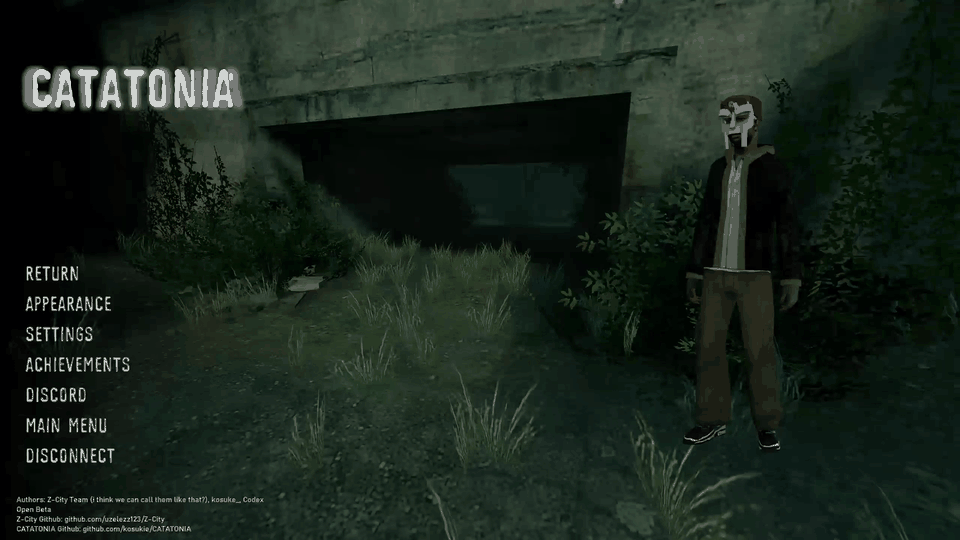

  
  
  
  

<a href="#english">English</a> • <a href="#русский">Русский</a>

*CATATONIA [Open Beta] is a horror-leaning fork of Z-City for Garry's Mod.*

## What's New in CATATONIA

- **Pause menu.** Inspired by *Afraid of Monsters: Director's Cut*, with the `AoM.ttf` typeface, a WON-style ghosting effect on the title, and a full-body 3D preview of your current character wearing their clothes, accessories, and armor.
- **Monochrome Derma.** A black-and-white redesign of the Settings, Appearance, and Achievements panels.
- **Weapon selector.** The AoM-style selector sits at the top center, with square slots using `AoM_HUD.ttf`, item counts in each slot, and white weapon silhouettes in worn frames.
- **Melee Sling.** This russet leather strap can be worn alongside the regular `Weapon Sling`. Switch slots and it keeps your two-handed melee weapon at your hip. It automatically picks up compatible melee weapons from third-party addons, too.
- **Body searches.** Switch to empty hands before searching corpses or ragdolls.

### Planned

- A psychopathy and hallucination system triggered by brutal kills.
- New round-start sounds.
- A redesigned HUD.

## Credits & License

**Z-City Johns** created the original gamemode. [Original repository · uzelezz123/Z-City](https://github.com/uzelezz123/Z-City)

CATATONIA is licensed under the **GNU Affero General Public License v3.0**. [License](LICENSE)

---

*CATATONIA [Open Beta] — хоррор-форк Z-City для Garry's Mod.*

## Что нового в CATATONIA

- **Пауз-меню.** Вдохновлено *Afraid of Monsters: Director's Cut*. Заголовок набран шрифтом `AoM.ttf` и переливается в духе WON. Справа видно текущего персонажа в полный рост, со всей одеждой, аксессуарами и бронёй.
- **Монохромная Derma.** Настройки, редактор внешности и достижения теперь в чёрно-белой гамме.
- **Селектор оружия.** В стиле AoM, по центру вверху экрана. Квадратные слоты со шрифтом `AoM_HUD.ttf`, счётчики предметов в каждом слоте и белые силуэты оружия в потёртых рамках.
- **Melee Sling.** Рыжий кожаный ремень можно носить вместе с обычным `Weapon Sling`. При смене слота он удерживает двуручное холодное оружие на бедре. Совместимое мили-оружие из сторонних аддонов подхватывается автоматически.
- **Обыск тел.** Чтобы обыскать труп или рэгдолл, сначала освободи руки. АНТИ-ХОМИГРАД СИСТЕМА!!!111!11!1!

### В планах

- Система психопатии и галлюцинаций после жестоких убийств.
- Новые звуки начала раунда.
- Переработка HUD.

## Авторы и лицензия

Оригинальный режим создала **Z-City Johns**. [Исходный репозиторий · uzelezz123/Z-City](https://github.com/uzelezz123/Z-City)

CATATONIA распространяется по лицензии **GNU Affero General Public License v3.0**. [Лицензия](LICENSE)

---

## Showcase / Screenshots

