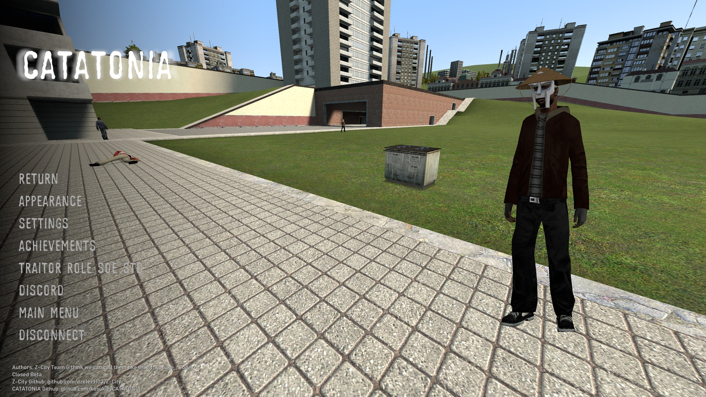

  
  
  
  

<em>CATATONIA is a horror-leaning fork of Z-City for Garry's Mod. The interface fades into shadow while the round carries on behind it.</em>

## What's New in CATATONIA

- **Pause menu.** Inspired by *Afraid of Monsters: Director's Cut*, with the `AoM.ttf` typeface, a WON-style ghosting effect on the title, and a full-body 3D preview of your current character wearing their clothes, accessories, and armor.
- **Monochrome Derma.** A black-and-white redesign of the Settings, Appearance, and Achievements panels.
- **Body searches.** Switch to empty hands before searching corpses or ragdolls.

### Planned

- A psychopathy and hallucination system triggered by brutal kills.
- New round-start sounds.
- A redesigned HUD and weapon selector.

## Showcase / Screenshots

## Credits & License

**Z-City Team** created the original gamemode. [Original repository · uzelezz123/Z-City](https://github.com/uzelezz123/Z-City)

CATATONIA is licensed under the **GNU Affero General Public License v3.0**. [License](LICENSE)
