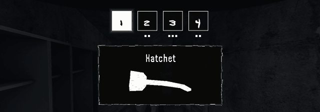
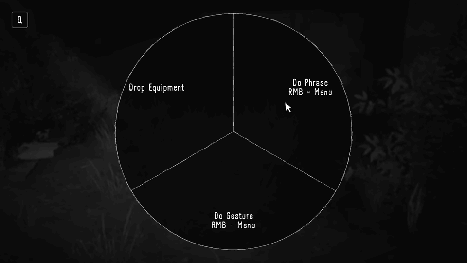
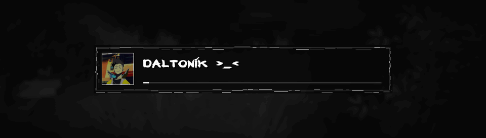

  
  
  
  

<a href="#english">English</a> • <a href="#русский">Русский</a>

*CATATONIA [Open Beta] is a horror-leaning fork of Z-City for Garry's Mod.*

## What's New in CATATONIA

- **Full HUD and interface redesign** inspired by *Afraid of Monsters: Director's Cut*.
  - **Pause menu** with the `AoM.ttf` typeface, a white WON-style title glow, and a full-body 3D preview of your current character in their clothes, accessories, and armor.
  - **Weapon selector** at the top center, with square slots numbered in `AoM_HUD.ttf`, per-slot item counts, and white weapon silhouettes in worn frames.
  - **Action wheel on `Q`** with worn white outlines.
  - **Voice chat** with monochrome speaker cards, square avatars, and a worn white frame and a volume bar that follows the speaker's voice.
  - **Monochrome Derma** for the Settings, Appearance, and Achievements panels.
- **Melee Sling.** This russet leather strap can be worn alongside the regular `Weapon Sling`. It holds any two-handed melee weapon at your hip when you switch slots and automatically detects compatible weapons from third-party addons.
- **Body searches.** Switch to empty hands before searching corpses or ragdolls. АНТИ-ХОМИГРАД СИСТЕМА!!!
- **Add-on loot in Homicide.** The loot pool includes melee weapons from *Cry of Fear & Afraid of Monsters* and a rare **Malorian Arms 3516** spawn from the standalone addon. Loot generation checks which weapons are registered and skips missing addon entries safely, avoiding Lua errors.

### Planned

- A psychopathy and hallucination system triggered by brutal kills.
- New round-start sounds.

## Credits & License

**Z-City Johns** created the original gamemode. [Original repository · uzelezz123/Z-City](https://github.com/uzelezz123/Z-City)

CATATONIA is licensed under the **GNU Affero General Public License v3.0**. [License](LICENSE)

---

*CATATONIA [Open Beta] — хоррор-форк Z-City для Garry's Mod.*

## Что нового в CATATONIA

- **Полный редизайн HUD и интерфейса** в духе *Afraid of Monsters: Director's Cut*.
  - **Пауз-меню** с белым WON-свечением заголовка, шрифтом `AoM.ttf` и 3D-превью текущего персонажа в полный рост, со всей одеждой, аксессуарами и бронёй.
  - **Селектор оружия** вверху по центру экрана, с квадратными слотами, цифрами в шрифте `AoM_HUD.ttf`, счётчиками предметов в каждом слоте и белыми силуэтами оружия в потёртых рамках.
  - **Радиальное меню действий на `Q`** с потёртыми белыми контурами.
  - **Голосовой чат** с монохромными плашками, квадратными аватарами, потёртой белой рамкой и индикатором громкости.
  - **Монохромная Derma** для настроек, редактора внешности и достижений.
- **Melee Sling.** Рыжий кожаный ремень можно носить вместе с обычным `Weapon Sling`. При смене слота он удерживает на бедре любое двуручное холодное оружие и автоматически распознаёт совместимое оружие из сторонних аддонов.
- **Обыск тел.** Чтобы обыскать труп или рэгдолл, сначала освободи руки. АНТИ-ХОМИГРАД СИСТЕМА!!!
- **Лут из аддонов в Homicide.** В лутпул добавлено холодное оружие из *Cry of Fear & Afraid of Monsters* и редкий спавн **Malorian Arms 3516** из отдельного аддона. При генерации лута игра проверяет регистрацию оружия и пропускает отсутствующие позиции без Lua-ошибок.

### В планах

- Система психопатии и галлюцинаций после жестоких убийств.
- Новые звуки начала раунда.

## Авторы и лицензия

Оригинальный режим создала **Z-City Johns**. [Исходный репозиторий · uzelezz123/Z-City](https://github.com/uzelezz123/Z-City)

CATATONIA распространяется по лицензии **GNU Affero General Public License v3.0**. [Лицензия](LICENSE)

---

## Showcase / Screenshots

