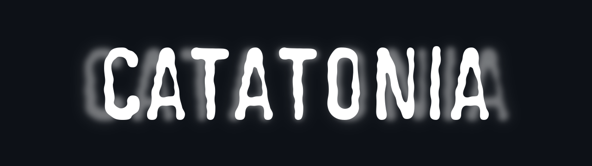

  
  
  
  

<a href="#english">English</a> • <a href="#русский">Русский</a>

*CATATONIA is a horror-leaning fork of Z-City for Garry's Mod. The round carries on behind the menu. At least we settled on a color scheme.*

## What's New in CATATONIA

- **Pause menu.** Inspired by *Afraid of Monsters: Director's Cut*, with the `AoM.ttf` typeface, a WON-style ghosting effect on the title, and a full-body 3D preview of your current character wearing their clothes, accessories, and armor.
- **Monochrome Derma.** A black-and-white redesign of the Settings, Appearance, and Achievements panels.
- **Body searches.** Switch to empty hands before searching corpses or ragdolls.

### Planned

- A psychopathy and hallucination system triggered by brutal kills.
- New round-start sounds.
- A redesigned HUD and weapon selector.

## Credits & License

**Z-City Team** created the original gamemode. [Original repository · uzelezz123/Z-City](https://github.com/uzelezz123/Z-City)

CATATONIA is licensed under the **GNU Affero General Public License v3.0**. [License](LICENSE)

---

*CATATONIA — хоррор-форк Z-City для Garry's Mod. Раунд продолжается даже за меню. Зато с цветовой гаммой мы определились.*

## Что нового в CATATONIA

- **Пауз-меню.** Вдохновлено *Afraid of Monsters: Director's Cut*. Заголовок набран шрифтом `AoM.ttf` и переливается в духе WON. Справа видно текущего персонажа в полный рост, со всей одеждой, аксессуарами и бронёй.
- **Монохромная Derma.** Настройки, редактор внешности и достижения теперь в чёрно-белой гамме.
- **Обыск тел.** Чтобы обыскать труп или рэгдолл, сначала освободи руки.

### В планах

- Система психопатии и галлюцинаций после жестоких убийств.
- Новые звуки начала раунда.
- Переработка HUD и селектора оружия.

## Авторы и лицензия

Оригинальный режим создала **Z-City Team**. [Исходный репозиторий · uzelezz123/Z-City](https://github.com/uzelezz123/Z-City)

CATATONIA распространяется по лицензии **GNU Affero General Public License v3.0**. [Лицензия](LICENSE)

---

## Showcase / Screenshots

